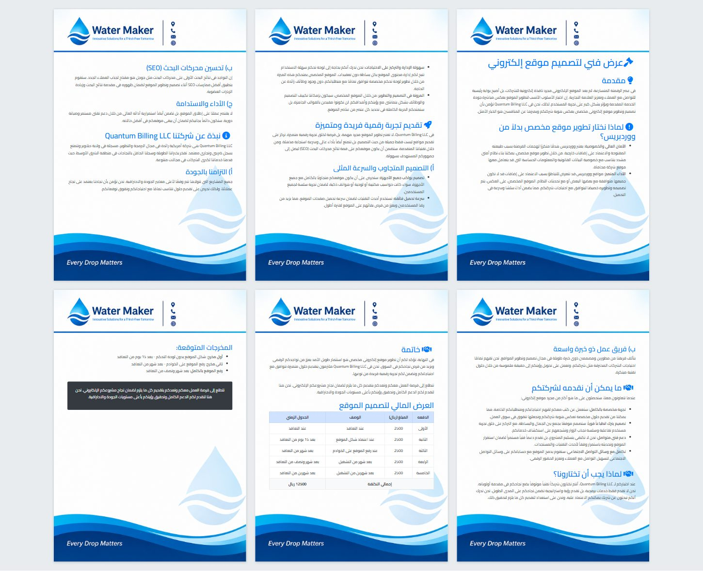
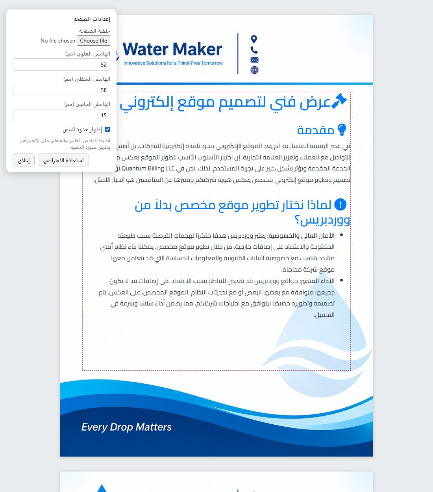
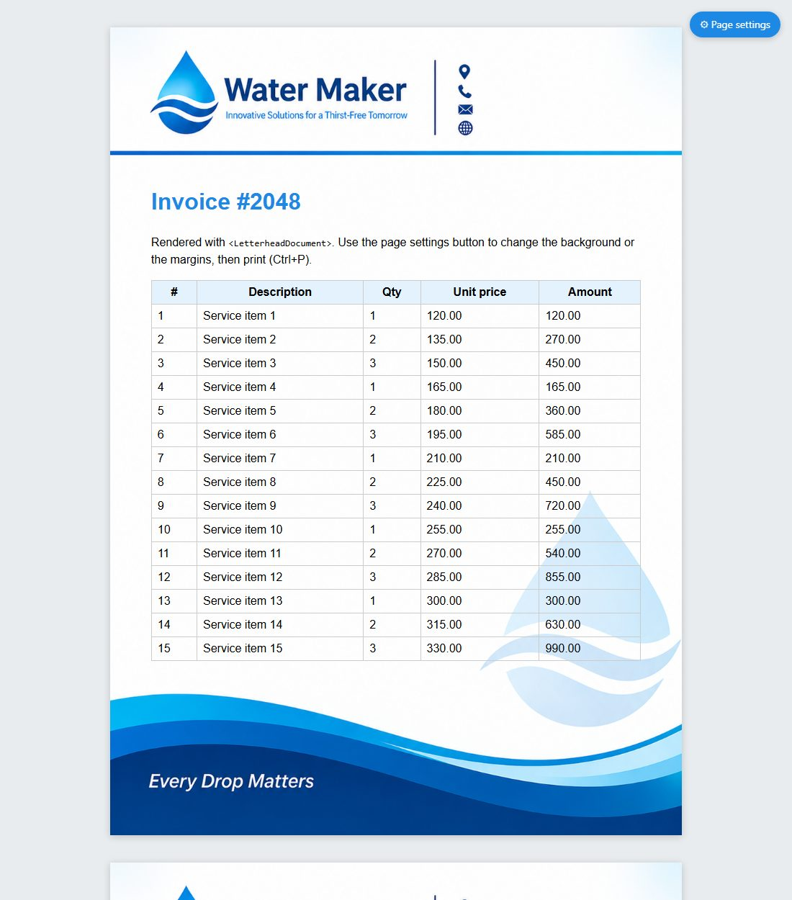
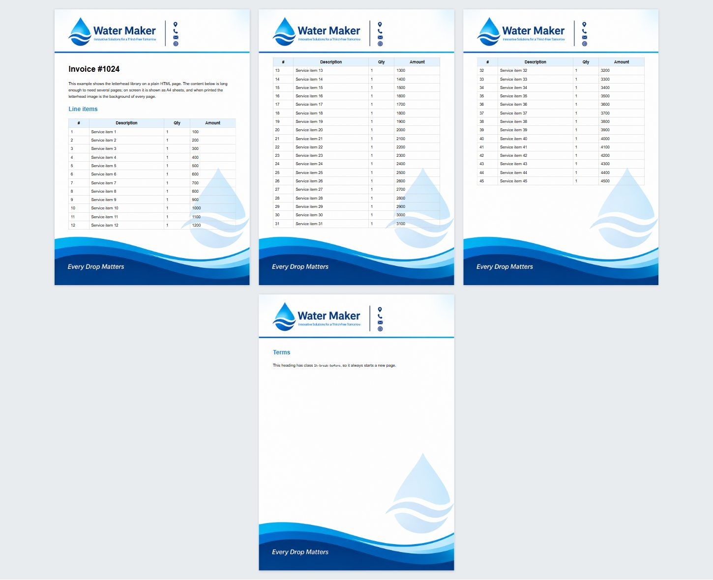

# letterhead-print

Print HTML documents with a **full-page letterhead image as the background of
every printed page**: logo and header at the top, contact strip or artwork at
the bottom. Your content flows between them, page after page. On screen, the
same document is shown as **A4 pages**, so what you see is what you print.

Works in plain HTML, in server-rendered templates, and in React. Supports RTL
(Arabic). The core is one CSS file and one dependency-free script.



## Features

- **Letterhead on every page.** One image (A4 proportions) becomes the page background, both on screen and in print.
- **Text never covers the letterhead.** Top and bottom margins reserve the image's header and footer areas on every page.
- **A4 page preview on screen.** Content is split into real pages: tables continue with their header row repeated, and headings stay with the text after them.
- **User page settings.** An on-screen panel to upload a different background and set the top, bottom and side margins. Changes apply live and are remembered in the browser.
- **Two print modes.** `fixed` for Chrome/Edge (the default), and `sheets` for engines that can't repeat a background, such as wkhtmltopdf.
- **React component** with live re-pagination when the data changes.
- **No dependencies.** The script is ES5 and runs in old engines too.

## Quick start (plain HTML)

Copy [`src/`](src) into your project as `letterhead/`, then:

```html
<link rel="stylesheet" href="letterhead/letterhead.css" />

<div class="lh-root" style="--lh-top: 52mm; --lh-bottom: 58mm; --lh-side: 15mm">
  
  <table class="lh-doc">
    <thead><tr><td><div class="lh-top"></div></td></tr></thead>
    <tbody>
      <tr>
        <td class="lh-content">
          <h1>Invoice #1024</h1>
          <p>Your document goes here…</p>
        </td>
      </tr>
    </tbody>
    <tfoot><tr><td><div class="lh-bottom"></div></td></tr></tfoot>
  </table>
  <div class="lh-pages"></div>
</div>

<script src="letterhead/letterhead.js"></script>
<script>
  Letterhead.settings(document.querySelector(".lh-root")); // optional: page settings panel
  Letterhead.auto();                                       // A4 page preview on screen
</script>
```

Open the page and press **Ctrl+P**. Every page carries the letterhead.

| Variable | Meaning |
| --- | --- |
| `--lh-top` | Space reserved for the image's header (mm) |
| `--lh-bottom` | Space reserved for the image's footer (mm) |
| `--lh-side` | Left/right text padding (mm) |

To work out the values for your image, use `mm = pixels from the edge ÷ image height in px × 297`.
Or tick **Show margins** in the settings panel and adjust until the dashed box
sits between the header and the footer:



## React

```jsx
import LetterheadDocument from "./letterhead/react/LetterheadDocument";
import LetterheadSettings, { useLetterheadSettings } from "./letterhead/react/LetterheadSettings";

export default function InvoicePrint({ invoice }) {
  const [settings, update, reset, saveError] = useLetterheadSettings("invoice-letterhead", {
    image: "/letterhead.png", top: 52, bottom: 58, side: 15,
  });

  return (
    <>
      <LetterheadSettings settings={settings} onChange={update} onReset={reset} saveError={saveError} />
      <LetterheadDocument
        background={settings.image}
        top={settings.top + "mm"}
        bottom={settings.bottom + "mm"}
        side={settings.side + "mm"}
        guides={settings.guides}
      >
        <h1>Invoice {invoice.number}</h1>
        {/* tables, lists, anything */}
      </LetterheadDocument>
    </>
  );
}
```



React 17 or newer, and it works with Vite, webpack and Next.js (as a client
component). In an app, print from a dedicated route so navbars aren't
printed. See [the guide](docs/guide.md#things-to-watch-in-a-react-app).

## Long tables

Tables are split across pages and their header row is repeated. A heading is
never left alone at the bottom of a page. Add `lh-break-before` to any element
to force a new page.



## Browser support

| Engine | Print (`fixed`) | Screen preview / `sheets` |
| --- | --- | --- |
| Chrome / Edge / Puppeteer / Playwright | ✅ tested | ✅ tested |
| Firefox | untested | untested |
| Safari | untested; use `sheets` | untested |
| wkhtmltopdf | ❌, use `sheets` | untested |

## Documentation

**[docs/guide.md](docs/guide.md)** is the full guide. It covers how it works,
the API, the settings panel, Laravel Blade, React, server-side PDFs
(Puppeteer, wkhtmltopdf) and known limits.

## Project structure

```text
src/
  letterhead.css               print layout, A4 sheets, settings panel styles
  letterhead.js                pagination + settings panel (window.Letterhead)
  react/
    LetterheadDocument.jsx     React wrapper
    LetterheadSettings.jsx     settings hook + panel
examples/
  basic.html                   minimal plain-HTML example
  offer-ar.html                real-world Arabic (RTL) document with Bootstrap
  react/                       React example (npm run build:example)
  assets/letterhead.png        sample letterhead (A4, 1055×1491)
docs/
  guide.md                     full documentation
  images/                      screenshots (generated)
scripts/
  screenshots.mjs              Playwright: screenshots + example PDFs
```

## Development

```bash
npm install
npm run build:example   # bundle the React example → examples/react/dist/
npm run screenshots     # regenerate docs/images/*.jpg and output/*.pdf
npm run pdf             # example PDFs only → output/
```

The scripts use the locally installed Google Chrome through Playwright. To use
Playwright's own Chromium instead, run `npx playwright install chromium` and
then set `PW_CHANNEL=` (empty).

The plain-HTML examples need no build: open `examples/basic.html` directly in
the browser.
