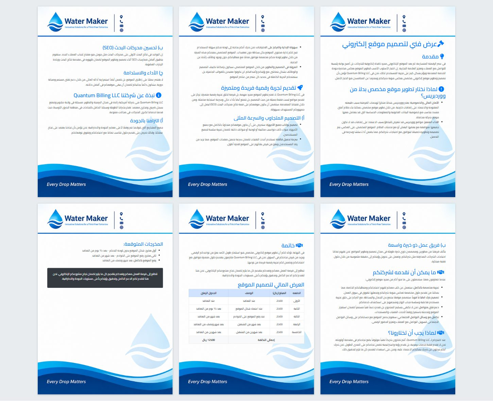
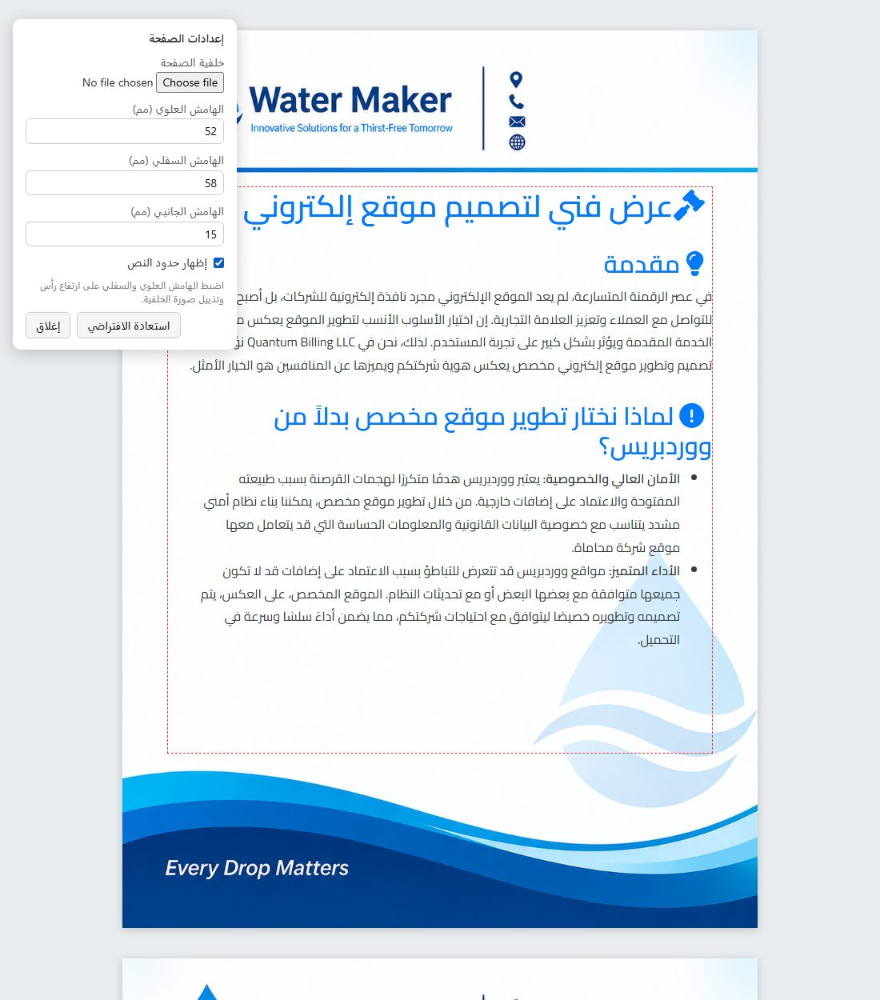

# Printing HTML with a full-page letterhead background

Print any HTML document so that a letterhead image (logo and header at the top,
contact strip at the bottom, watermark in the middle) is the background of
**every printed page**, while the text flows between the header and footer
areas. The same markup also shows the document **as A4 pages on screen**.

The library is in [`src/`](../src). To use it in a project, copy that folder
into the project as `letterhead/` (the snippets below assume that name).

| File | What it is |
| --- | --- |
| [`letterhead.css`](../src/letterhead.css) | The print layout, the screen sheets, and the two print modes |
| [`letterhead.js`](../src/letterhead.js) | Splits the content into A4 sheets (ES5, no dependencies, exposes `window.Letterhead`) |
| [`react/LetterheadDocument.jsx`](../src/react/LetterheadDocument.jsx) | React wrapper component |
| [`react/LetterheadSettings.jsx`](../src/react/LetterheadSettings.jsx) | React page-settings hook and panel |
| [`examples/basic.html`](../examples/basic.html) | Working plain-HTML example |
| [`examples/react/`](../examples/react) | Working React example (`npm run build:example`) |

[`examples/offer-ar.html`](../examples/offer-ar.html) is a real document (an Arabic offer built with Bootstrap) that
uses these files. When you use Bootstrap, add this override so `.container`
fills the letterhead's text width:

```css
.lh-root .container { max-width: none !important; padding: 0 !important; }
```

---

## 1. How it works



```text
┌──────── printed page (A4, @page margin 0) ────────┐
│ ▓▓▓ letterhead header (part of the image) ▓▓▓     │ ← <thead> spacer, --lh-top tall,
│───────────────────────────────────────────────────│   repeated on every page
│                                                   │
│   your content (.lh-content)                      │ ← flows page to page,
│   padded left/right by --lh-side                  │   watermark shows through
│                                                   │
│───────────────────────────────────────────────────│
│ ▓▓▓ letterhead footer (part of the image) ▓▓▓     │ ← <tfoot> spacer, --lh-bottom tall,
└───────────────────────────────────────────────────┘   repeated on every page
  background:  position: fixed, 210×297mm
```

There are three parts:

1. **The background.** `` with `position: fixed` and the size
   of a full A4 page. When printing, Chrome and Edge repeat fixed elements on
   every page. Because it is a real `` and not a CSS background, it
   prints even when "Background graphics" is turned off in the print dialog.
2. **The spacers.** The content sits in a one-column `<table>`. Browsers repeat
   `<thead>` and `<tfoot>` (`table-header-group` / `table-footer-group`) on every
   printed page. Here they hold **empty** divs that are exactly as tall as the
   image's header and footer areas, so the text never prints over them.
3. **The screen sheets.** A screen has no pages, so `letterhead.js`
   copies the content into fixed-size A4 sheets, each with the image as its
   CSS background:
   - lists and tables can continue on the next sheet, and a continued table
     repeats its header row;
   - a heading never ends up alone at the bottom of a sheet;
   - an element with class `lh-break-before` always starts a new sheet (it
     also forces a page break when printing).

### Two print modes

| Mode | How | Use when |
| --- | --- | --- |
| `fixed` (default) | Prints the table; the browser repeats the fixed image | Printing from Chrome/Edge, Puppeteer, headless Chrome |
| `sheets` | Add class `lh-print-sheets` to `.lh-root`; prints the sheets themselves, one sheet per page | The engine does not repeat fixed elements (e.g. wkhtmltopdf), or you want print to match the screen exactly |

### Tuning for a different letterhead image

The image should have A4 proportions (1 : 1.414, e.g. 1240×1754 px or larger
for sharp print). Measure its header and footer heights and set them in mm:

```text
mm = pixels_from_edge / image_height_px × 297
```

For the example image [`examples/assets/letterhead.png`](../examples/assets/letterhead.png)
(1055×1491), the header line ends at ≈232 px, which is 46 mm, so
`--lh-top: 52mm` leaves a small gap. The highest point of the footer wave is
≈263 px from the bottom, which is 52 mm, so `--lh-bottom: 58mm`. The
library's built-in defaults are 58 / 40 / 15 mm; set your own values on each
page.



```html
<div class="lh-root" style="--lh-top: 52mm; --lh-bottom: 58mm; --lh-side: 15mm">
```

### Letting the user change the background and margins

These values are the page's defaults. To let users switch to a different
letterhead without editing code, turn on the **page settings panel**. It is a
"⚙ Page settings" button in the corner of the screen, and it never prints. It
has these fields:

| Field | Effect |
| --- | --- |
| Page background | Upload an image; it replaces the letterhead on screen and in print |
| Top margin (mm) | Space kept clear for the background's header (`--lh-top`) |
| Bottom margin (mm) | Space kept clear for the background's footer (`--lh-bottom`) |
| Side margin (mm) | Left/right text padding (`--lh-side`) |
| Show margins | Dashed outline around the text area, to line it up with the image |
| Reset | Back to the defaults written in the page |

Changes apply and re-paginate immediately. They are remembered in that
browser (`localStorage`, under the `storageKey` you choose), so the next
print uses them too. The uploaded image is stored as a `data:` URL. If it is
too large for the browser's storage (about 5 MB), it is still applied but not
remembered, and the panel says so.

The quickest way to tune margins: tick **Show margins**, then raise **Top
margin** until the dashed box starts just below the header line in the image.
Do the same with **Bottom margin** for the footer.

Plain HTML: [section 2](#2-plain-html-page). React: [section 4](#4-react).

---

## 2. Plain HTML page

```html
<link rel="stylesheet" href="letterhead/letterhead.css" />

<div class="lh-root" style="--lh-top: 58mm; --lh-bottom: 40mm; --lh-side: 15mm">
  
  <table class="lh-doc">
    <thead><tr><td><div class="lh-top"></div></td></tr></thead>
    <tbody>
      <tr>
        <td class="lh-content">
          <!-- your document here -->
          <h1>Invoice #1024</h1>
          <p>…</p>
        </td>
      </tr>
    </tbody>
    <tfoot><tr><td><div class="lh-bottom"></div></td></tr></tfoot>
  </table>
  <div class="lh-pages"></div>
</div>

<script src="letterhead/letterhead.js"></script>
<script>Letterhead.auto();</script>
```

`Letterhead.auto()` waits for the page and web fonts to load, then paginates
every `.lh-root`. If content arrives later (AJAX), call
`Letterhead.paginate(rootElement)` again after you insert it.

Without the script, the page still prints correctly. The screen just shows
one long page instead of sheets.

For Arabic, put `dir="rtl"` on `<html>` or on `.lh-root`.

### API

```js
Letterhead.paginate(rootEl, {
  image: "letterhead.png",           // default: src of the .lh-bg 
  splitClasses: ["container", "section", "lh-split"], // blocks that may break across sheets
}); // returns the number of sheets

Letterhead.auto(options); // paginate every .lh-root once fonts are loaded
```

To let your own wrapper divs break across sheets, give them class `lh-split`.
Any other `div` moves to the next sheet as one block.

### Page settings panel (plain HTML)

Call `Letterhead.settings` before `Letterhead.auto()`:

```js
var ctl = Letterhead.settings(document.querySelector(".lh-root"), {
  storageKey: "offer-letterhead", // use a different key per document type
  open: false,                    // start collapsed (default)
  labels: {                       // optional: any label, e.g. Arabic
    title: "إعدادات الصفحة",
    top: "الهامش العلوي (مم)",
    bottom: "الهامش السفلي (مم)",
  },
});

ctl.get();                    // { image, top, bottom, side, guides }
ctl.set({ top: 70, bottom: 45 }); // apply + remember + re-paginate
ctl.reset();                  // back to the values written in the page
```

The defaults come from the page itself: the `.lh-bg` image `src` and the
`--lh-*` values on `.lh-root`. Only the values that differ from them are
saved. Label keys: `title`, `image`, `top`, `bottom`, `side`, `guides`,
`reset`, `close`, `hint`, `notSaved`. [`examples/offer-ar.html`](../examples/offer-ar.html) shows a
full Arabic set.

The `ctl.set` call also lets you load settings from your server instead,
for example per company: `ctl.set({ image: company.letterheadUrl, top: company.top })`.

---

## 3. Server-rendered templates (Laravel Blade, other server templates)

The pattern is just markup. Wrap your report in it from a shared layout so
every printable page gets the letterhead. A Blade component, for example:

```blade
{{-- resources/views/components/letterhead.blade.php --}}
@props(['image' => asset('images/letterhead.jpg'), 'top' => '58mm', 'bottom' => '40mm', 'side' => '15mm'])

<link rel="stylesheet" href="{{ asset('letterhead/letterhead.css') }}">
<div class="lh-root" style="--lh-top: {{ $top }}; --lh-bottom: {{ $bottom }}; --lh-side: {{ $side }}">
  
  <table class="lh-doc">
    <thead><tr><td><div class="lh-top"></div></td></tr></thead>
    <tbody><tr><td class="lh-content">{{ $slot }}</td></tr></tbody>
    <tfoot><tr><td><div class="lh-bottom"></div></td></tr></tfoot>
  </table>
  <div class="lh-pages"></div>
</div>
<script src="{{ asset('letterhead/letterhead.js') }}"></script>
<script>Letterhead.auto();</script>
```

```blade
<x-letterhead>
  <h1>Statement</h1>
  …
</x-letterhead>
```

If different companies or branches have different letterheads, pass `image`
and the spacing values per company, read from the database.

---

## 4. React

```jsx
import LetterheadDocument from "./letterhead/react/LetterheadDocument";

export default function InvoicePrint({ invoice }) {
  return (
    <>
      <button className="no-print" onClick={() => window.print()}>Print</button>

      <LetterheadDocument
        background="/letterhead.png"   // put the image in /public
        top="58mm"
        bottom="40mm"
        side="15mm"
        dir="rtl"
      >
        <h1>فاتورة رقم {invoice.number}</h1>
        <table className="items">
          <thead><tr><th>#</th><th>الوصف</th><th>المبلغ</th></tr></thead>
          <tbody>
            {invoice.lines.map((l, i) => (
              <tr key={l.id}><td>{i + 1}</td><td>{l.text}</td><td>{l.amount}</td></tr>
            ))}
          </tbody>
        </table>
      </LetterheadDocument>
    </>
  );
}
```

Copy the library's `src/` folder into the app as `src/letterhead/`.
The component imports `../letterhead.css` and `../letterhead.js`
itself. This works with Vite, webpack/CRA and Next.js.

| Prop | Default | Meaning |
| --- | --- | --- |
| `background` | — | Letterhead image URL (required) |
| `top` / `bottom` / `side` | `58mm` / `40mm` / `15mm` | Spacings, see "Tuning" above |
| `preview` | `true` | Show A4 sheets on screen |
| `printMode` | `"fixed"` | `"sheets"` prints the sheets (see the two print modes) |
| `guides` | `false` | Outline the text area on screen |
| `dir` | — | `"rtl"` for Arabic |

The component re-paginates by itself when the children change (data loaded,
edits) and when images inside the content finish loading. It uses a
`MutationObserver`.

### Page settings in React

[`react/LetterheadSettings.jsx`](../src/react/LetterheadSettings.jsx)
provides a hook that holds and remembers the settings, plus the panel
component:

```jsx
import LetterheadDocument from "./letterhead/react/LetterheadDocument";
import LetterheadSettings, { useLetterheadSettings } from "./letterhead/react/LetterheadSettings";

export default function InvoicePrint({ invoice }) {
  const [settings, update, reset, saveError] = useLetterheadSettings("invoice-letterhead", {
    image: "/letterhead.png", top: 58, bottom: 40, side: 15, // defaults (mm)
  });

  return (
    <>
      <LetterheadSettings
        settings={settings}
        onChange={update}
        onReset={reset}
        saveError={saveError}
        labels={{ title: "إعدادات الصفحة", top: "الهامش العلوي (مم)", bottom: "الهامش السفلي (مم)" }}
      />
      <LetterheadDocument
        background={settings.image}
        top={settings.top + "mm"}
        bottom={settings.bottom + "mm"}
        side={settings.side + "mm"}
        guides={settings.guides}
        dir="rtl"
      >
        …
      </LetterheadDocument>
    </>
  );
}
```

`settings` is a plain object, `{ image, top, bottom, side, guides }`. If the
letterhead should follow the user across devices, or be set once per
company, replace the `localStorage` part of `useLetterheadSettings` with a
call to your API and keep the same shape.

### Things to watch in a React app

- **Print only the document, not the whole app.** `window.print()` prints the
  entire page, including navbars and sidebars. Options, best first:
  1. **A dedicated print route** (`/invoices/:id/print`) that renders only
     `<LetterheadDocument>`. Open it in a new tab and call `window.print()`.
     This is the simplest and most reliable option.
  2. Hide the app chrome in print:
     `@media print { .app-nav, .app-sidebar, .no-print { display: none !important; } }`.
  3. `react-to-print`: it copies the component into an iframe together with the
     page's styles. Point it at the `.lh-root` element.
- **No `transform`, `filter` or `perspective` on any ancestor** of the
  component (common with page-transition or animation wrappers). Any of these
  makes `position: fixed` relative to that ancestor, and the background then
  prints on the first page only. If you can't remove it, use
  `printMode="sheets"`.
- **The sheets are copies.** Buttons and inputs inside the content work in the
  original, not in the screen sheets. Keep interactive controls outside
  `<LetterheadDocument>`, or set `preview={false}` while editing.
- **SSR / Next.js App Router.** Put `"use client"` in the file that renders
  the component. The paginator does nothing on the server.
- **Fonts.** Pagination waits for `document.fonts.ready`, because line heights
  depend on the font. Load web fonts in the page `<head>`, not lazily.

---

## 5. Generating PDFs on a server

### Headless Chrome / Puppeteer (recommended)

The default `fixed` mode works as-is. Chrome prints with print media, so the
screen script doesn't matter.

```bash
chrome --headless=new --no-pdf-header-footer --print-to-pdf=out.pdf https://…/invoice/1024/print
```

```js
const page = await browser.newPage();
await page.goto(url, { waitUntil: "networkidle0" });
await page.pdf({
  path: "invoice.pdf",
  format: "A4",
  preferCSSPageSize: true, // use @page { size: A4; margin: 0 }
  printBackground: true,   // needed for "sheets" mode (CSS backgrounds)
});
```

### wkhtmltopdf (old WebKit engine)

wkhtmltopdf is based on old Qt WebKit and is not expected to repeat
`position: fixed` elements on every page. It also doesn't support CSS
variables (the CSS has literal fallbacks, so the defaults still apply). Use
**sheets** mode:

```html
<div class="lh-root lh-print-sheets"> … </div>
```

```bash
wkhtmltopdf --print-media-type --page-size A4 \
  -T 0 -B 0 -L 0 -R 0 --disable-smart-shrinking \
  --javascript-delay 1000 page.html out.pdf
```

> **Not tested yet.** wkhtmltopdf is not installed on this machine. Check the
> output, especially the sheet height (wkhtmltopdf's DPI and shrinking can
> make 297 mm come out slightly too tall, which pushes each sheet onto two
> pages).

---

## 6. Browser support and testing status

| Engine | `fixed` mode | `sheets` mode / screen preview |
| --- | --- | --- |
| Chrome / Edge (desktop, headless) | ✅ tested | ✅ tested |
| Puppeteer | ✅ same engine as Chrome | ✅ |
| Firefox | not tested; Firefox also repeats fixed elements in print | not tested |
| Safari | not tested; may print the fixed image on the first page only, so use `sheets` | not tested |
| wkhtmltopdf | ❌ expected not to work | not tested, see above |

**How it was tested.** Headless Chrome `--print-to-pdf` on `examples/offer-ar.html`,
`examples/basic.html` (both print modes) and the React component
(React 18.3.1, with content changing after the first render). Every page
showed the letterhead, and the content stayed clear of the header and footer
areas.

## 7. Known limits

- A single block taller than one page (for example a huge image) is clipped
  in the screen and sheets views. Print `fixed` mode still breaks it normally.
- The screen preview estimates the breaks. In `fixed` mode the browser's own
  print breaks can differ by a line or two. Use `sheets` mode when screen and
  paper must match exactly.
- A4 portrait only. For Letter or landscape, change `@page size` and the
  210mm/297mm sizes in `letterhead.css`.
